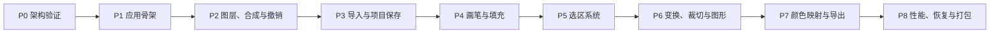

# EasyPicture 技术评估与开发执行计划

- 状态：拟执行
- 日期：2026-07-24
- 依据：用户提供的《轻量化图像处理应用技术栈说明》
- 当前仓库：P0～P6R 已完成自动及人工验收

## 1. 执行结论

结论：**建议立项，保留原技术栈，但先修订底层数据与性能方案再编码。**

原文选择的 `Python + PySide6 + NumPy + OpenCV + Pillow + Nuitka` 适合本地、离线、Windows 优先的个人位图编辑器。UI、图像算法、文件格式和部署工具之间的职责划分大体合理，第一版也正确排除了 PSD 完整兼容、16 位/HDR、云服务、插件市场和真正矢量图层。

技术方案可评为：

| 维度 | 评价 | 说明 |
| --- | --- | --- |
| 产品范围 | 良好 | 边界明确，适合个人工具 |
| UI 技术 | 良好 | Qt Widgets 与传统图像编辑器契合 |
| 图像处理生态 | 良好 | NumPy/OpenCV/Pillow 分工合理 |
| 数据模型 | 需修订 | 整层数组、图层偏移和缓存职责尚有冲突 |
| 大图内存策略 | 风险较高 | 8192×8192 与整层数组/整图缓存无法同时成立 |
| 撤销策略 | 方向正确 | 需要从“命令数量”升级为可度量的内存策略 |
| 色彩与 Alpha | 定义不足 | 需要固定工作色彩空间和预乘 Alpha 边界 |
| 工期估计 | 偏乐观 | 原估计没有充分计入性能验证、容错和打包回归 |

在开始功能开发前，必须先冻结以下五个基础契约：

1. 像素存储契约；
2. Alpha 与颜色通道契约；
3. 文档、渲染缓存和 UI 的所有权边界；
4. 命令及撤销数据的生命周期；
5. 后台任务的快照、取消和提交规则。

## 2. 修订后的 V1 产品边界

### 2.1 支持范围

- Windows 11 x64 为主目标，Windows 10 22H2 仅做尽力兼容；
- 单窗口、单文档工作流；多窗口和标签页后置；
- 本地离线运行，不需要账户、网络和自动更新；
- 8 位 sRGB RGBA 位图；
- 日常目标：4096×4096、最多约 10 个全尺寸图层；
- 上限目标：8192×8192，但属于大图模式，图层数量和实时操作能力受内存限制；
- 项目保存为 `.limg`，普通图片通过“导出”生成；
- V1 包含图层、画笔/橡皮擦、油漆桶、矩形选区/魔棒、自由变换、裁切/缩放、基础图形、颜色映射和常用格式导出。

### 2.2 明确不做

- PSD 工程兼容；
- 16 位、浮点、HDR、CMYK 编辑；
- 专业软打样和多工作色彩空间；
- 矢量图层、文字图层、调整图层；
- GPU 图像算法和 GPU 计算画笔（显示合成已在 P6R 使用 OpenGL）；
- 插件系统、脚本市场；
- 批量处理和 `pyvips` 集成；
- 多文档全局撤销组；
- 非破坏性滤镜栈。

### 2.3 “8192×8192 支持”的实际含义

一张 8192×8192 RGBA 图层原始像素约为 256 MiB。若同时保留权威数组、QImage 缓存、合成缓存和撤销副本，单图层就可能消耗数倍内存。因此：

- 不能把“8192 上限”理解为“任意数量全尺寸图层都流畅”；
- 应从第一天采用 256×256 分块存储和按需渲染；
- 打开或创建文档前估算内存，并在高风险时警告；
- 全图导出、缩放和颜色映射允许后台运行；
- 发布验收以 4096×4096 日常场景为主，8192×8192 使用单独的大图测试。

## 3. 技术选型定案

| 项目 | V1 决策 | 备注 |
| --- | --- | --- |
| Python | 3.14 x64 | 固定小版本范围，避免开发机与打包机漂移 |
| UI | PySide6 + Qt Widgets | `QMainWindow`、Dock、Action、快捷键 |
| 画布 | `QGraphicsView` + `QOpenGLWidget` viewport | 完整帧 GPU 显示，软件后端可回退 |
| 权威像素 | NumPy `uint8`、C-contiguous、straight RGBA | 每块 256×256，边缘块可更小 |
| 选区 | NumPy `uint8` 单通道分块蒙版 | 0～255，可表示羽化 |
| 显示缓存 | `QImage.Format_RGBA8888_Premultiplied` | 仅存在于渲染层，不进入领域模型 |
| 图像算法 | OpenCV headless | 洪水填充、变换、缩放、形态学 |
| 导入导出 | Pillow + ImageCms | EXIF 方向、ICC 转换和常用格式 |
| 撤销 UI | `QUndoStack` / `QUndoCommand` | 像素负载由独立 PatchStore 管理 |
| 测试 | pytest + pytest-qt | 纯算法、golden image、UI 流程 |
| 代码质量 | Ruff + mypy | CI 与本地统一 |
| 打包 | Nuitka standalone | onefile 不进入 V1 验收 |
| 可选依赖 | pyvips | V1 不安装，确认有批处理需求后再评估 |

依赖采用锁文件固定。首次引导时选择当时可用且相互兼容的稳定版本，之后只通过专门的依赖升级任务更新，不能在日常功能提交中顺手升级。

## 4. 关键架构修订

### 4.1 领域模型不持有 QImage

原方案把 `display_cache` 放进 `RasterLayer`，容易让文档模型依赖 Qt、混淆权威数据和派生缓存。修订为：

```text
Document
├── canvas_size
├── layers[]
├── active_layer_id
├── selection
├── working_color_space = sRGB
├── revision
├── project_path
└── dirty_state

RasterLayer
├── id
├── name
├── visible / opacity / locked / alpha_locked
├── origin
├── pixel_store
├── optional layer_mask
└── revision

RenderCache
├── premultiplied QImage tiles
├── composite tiles
└── cache keys: layer id + tile + revision
```

`RasterLayer` 只保存领域数据。QImage、视口缓存和缩放缓存全部由渲染层持有，可随时丢弃并从权威像素重建。

### 4.2 从第一版使用 TilePixelStore

不先实现“整层 ndarray”，再在后期改成分块。该迁移会影响画笔、选区、合成、撤销、保存和所有图像算法，返工代价过高。

建议核心接口：

```python
class TilePixelStore:
    tile_size: int = 256

    def read_tile(self, tx: int, ty: int) -> NDArray[np.uint8]: ...
    def writable_tile(self, tx: int, ty: int) -> NDArray[np.uint8]: ...
    def read_region(self, rect: Rect) -> NDArray[np.uint8]: ...
    def write_region(self, rect: Rect, pixels: NDArray[np.uint8]) -> DirtyRegion: ...
    def iter_tiles(self, rect: Rect | None = None): ...
```

规则：

- 缺失 RGBA Tile 视为全透明；
- 缺失选择蒙版 Tile 视为未选择；
- 写入前使用 copy-on-write，不能让后台任务和撤销快照引用可变数组；
- 每次写入递增 Tile 和 Layer revision；
- 脏区至少精确到 Tile，工具可额外提供更小的 dirty rectangle；
- 图层采用局部像素坐标加 `origin`，避免为小图层分配整张文档大小。

### 4.3 固定 Alpha 和通道语义

领域层只使用：

```text
通道顺序：R, G, B, A
数据类型：uint8
Alpha：straight / unassociated
内存：C-contiguous
工作色彩空间：sRGB
```

渲染桥负责转换成预乘 Alpha QImage。禁止把预乘数据交给 OpenCV/Pillow 算法，也禁止把 straight RGBA 误标为 premultiplied QImage。

必须用 golden tests 覆盖：

- 半透明红叠加半透明蓝；
- Alpha 为 0 但 RGB 非 0；
- 橡皮擦后的边缘；
- 图层不透明度；
- 变换后透明边缘；
- NumPy → QImage → NumPy 往返。

V1 使用 sRGB 编码值进行合成，不实现线性光合成。这不是专业色彩流程，但与产品定位一致，必须在文档中明确。

### 4.4 区分“保存项目”和“导出图片”

菜单语义固定为：

- `保存/另存为`：写入 `.limg`，保留图层和项目状态；
- `导出`：生成 PNG/JPEG/WebP/BMP/TIFF/TGA；
- 打开普通图片：创建未命名项目；
- 打开 `.limg`：恢复项目；
- 导出成功不能清除项目的 modified 状态；
- 只有 `.limg` 保存成功后才调用 `undo_stack.setClean()`。

### 4.5 `.limg` 文件必须可迁移、可校验、原子保存

仍采用 ZIP 容器，但增加：

```json
{
  "format": "easypicture",
  "schema_version": 1,
  "app_version": "0.1.0",
  "canvas": {"width": 1920, "height": 1080},
  "working_color_space": "sRGB",
  "active_layer_id": "uuid",
  "layers": []
}
```

实现要求：

- 同目录临时文件写完并校验后再原子替换；
- 打开前校验 schema、路径、数量、尺寸和解压后总大小；
- 拒绝绝对路径、`..` 路径和异常压缩比条目；
- 图层使用无损 PNG 或内部原始压缩块，不能用有损格式；
- 加载失败不能破坏当前已打开文档；
- 每个 schema 版本都有迁移入口；
- 不使用 Pickle；
- 首个可用版本就实现崩溃恢复草稿，恢复文件与正式项目分离。

### 4.6 撤销必须按内存成本管理

`QUndoStack` 负责命令顺序、Action 和 clean state；独立 `UndoPatchStore` 保存压缩 Tile 快照。

```text
QUndoCommand
└── PatchHandle[]
    ├── tile coordinate
    ├── before blob
    ├── after blob
    └── uncompressed/compressed byte count
```

规则：

- 一次按下到抬起是一条 `BrushStrokeCommand`；
- 像素命令只保存受影响 Tile 的 before/after；
- Tile 快照使用快速无损压缩；
- 默认最多 100 条命令，同时设置撤销数据内存预算；
- 大型命令执行前估算成本；
- 超过预算时应清理旧历史或在执行前提示，不能静默耗尽内存；
- 裁切、全图缩放等操作可以使用临时文件保存大快照；
- 任何命令的 redo/undo 都必须只通过同一领域服务修改文档。

### 4.7 后台任务不能持有可变文档

后台任务输入必须是不可变快照、复制的受影响 Tile 或文件路径，输出为结果对象：

```text
UI 请求
→ 捕获 document/layer revision
→ Worker 计算
→ 返回 OperationResult
→ 主线程校验 revision
→ 通过 Command 提交，或丢弃过期结果
```

需要支持取消令牌。Worker 不直接修改 Document、QImage、Widget 或 QUndoStack。

## 5. 建议代码结构

```text
EasyPicture/
├── pyproject.toml
├── README.md
├── docs/
│   ├── development_plan.md
│   └── adr/
├── src/
│   └── easypicture/
│       ├── __main__.py
│       ├── app.py
│       ├── domain/
│       │   ├── document.py
│       │   ├── layer.py
│       │   ├── selection.py
│       │   └── events.py
│       ├── pixels/
│       │   ├── tile_store.py
│       │   ├── patches.py
│       │   └── formats.py
│       ├── imaging/
│       │   ├── composite.py
│       │   ├── region_select.py
│       │   ├── transform.py
│       │   ├── resample.py
│       │   └── color_map.py
│       ├── render/
│       │   ├── canvas_renderer.py
│       │   ├── qimage_bridge.py
│       │   └── render_cache.py
│       ├── tools/
│       │   ├── protocol.py
│       │   ├── brush.py
│       │   ├── bucket.py
│       │   ├── wand.py
│       │   ├── transform.py
│       │   ├── crop.py
│       │   └── shapes.py
│       ├── commands/
│       │   ├── undo_store.py
│       │   ├── layer_commands.py
│       │   ├── pixel_commands.py
│       │   └── document_commands.py
│       ├── persistence/
│       │   ├── image_io.py
│       │   ├── project_io.py
│       │   ├── migrations.py
│       │   └── recovery.py
│       ├── jobs/
│       │   ├── runner.py
│       │   └── results.py
│       └── ui/
│           ├── main_window.py
│           ├── canvas_view.py
│           ├── overlays.py
│           ├── layers_panel.py
│           └── tool_options.py
├── tests/
│   ├── unit/
│   ├── golden/
│   ├── integration/
│   ├── ui/
│   └── performance/
└── scripts/
    ├── test.ps1
    └── package.ps1
```

依赖方向固定为：

```text
UI / Tools / Commands
        ↓
Domain services
        ↓
Pixels / Imaging

Persistence → Domain + Pixels
Render      → Domain read API + Pixels
```

`domain`、`pixels` 和大部分 `imaging` 模块不导入 PySide6，确保核心算法可以在无 GUI 环境下测试。

## 6. 分阶段开发计划



工时是单人、AI 辅助、包含测试和文档的工程估算，不是承诺工期。

### P0：架构验证与工程初始化，16～24 小时

任务：

- 初始化 Git、`pyproject.toml`、`src` 布局和虚拟环境；
- 固定 Python 3.14 和依赖锁文件；
- 配置 Ruff、mypy、pytest、pytest-qt；
- 编写像素格式、Tile Store、线程模型和项目格式 ADR；
- 做 NumPy ↔ QImage 桥接原型；
- 做 256/512 Tile 对比基准；
- 测试 4096 与 8192 文档的内存估算；
- 创建最小 Nuitka standalone 包，尽早验证 Qt 插件。

验收：

- 一条命令可启动空白 Qt 窗口；
- 一条命令可运行 lint、类型检查和测试；
- RGBA 往返 golden test 通过；
- 选定 Tile 大小并记录基准依据；
- standalone 包可在未配置 Python 的测试环境启动。

### P1：应用骨架与文档模型，24～36 小时

任务：

- `QMainWindow`、菜单、工具栏、Dock、状态栏；
- 单文档生命周期：新建、关闭、未保存确认；
- `Document`、`RasterLayer`、`Selection` 和领域事件；
- `QGraphicsView` 的缩放、平移、坐标转换；
- 工具协议、ToolContext 和 Overlay 管理；
- 前景色/背景色与基础设置持久化。

验收：

- 新建指定尺寸文档；
- 视图缩放不修改像素；
- 屏幕、场景、文档、图层坐标有单元测试；
- 切换工具不会残留 Overlay 或事件捕获；
- 关闭修改文档时正确提示。

### P2：Tile、图层合成与撤销骨架，40～56 小时

任务：

- `TilePixelStore` 和 `MaskTileStore`；
- straight RGBA 到 premultiplied QImage 缓存；
- 可见 Tile 合成、dirty invalidation；
- 图层新建、删除、复制、重命名、排序、显隐、不透明度；
- 普通 source-over 合成；
- `QUndoStack`、PatchStore 和命令基类；
- 图层命令和最小像素补丁命令；
- 图层锁定和透明像素锁定契约。

验收：

- 10 个 4096 全尺寸测试图层可以正确合成；
- 半透明、偏移和不透明度 golden tests 逐像素通过；
- 任意图层操作可连续 undo/redo 100 次且状态一致；
- 修改一个 Tile 不会使无关 Tile 缓存失效；
- 领域模型中没有 QImage。

### P3：导入、项目保存与恢复，28～40 小时

任务：

- Pillow 导入 PNG/JPEG/WebP/BMP/TIFF/TGA；
- 处理 EXIF Orientation；
- 有 ICC 时转换到 sRGB，无 ICC 时按 sRGB 解释；
- `.limg` schema、写入、读取和迁移入口；
- 原子保存、异常回滚和损坏文件提示；
- 自动恢复草稿；
- 缩略图和基础元数据。

验收：

- 常用格式样本导入结果正确；
- `.limg` 保存后重开，图层像素和属性一致；
- 模拟写入中断不会覆盖原项目；
- 拒绝路径穿越、尺寸越界和异常解压大小；
- 导出普通图片不会清除项目 modified 状态。

里程碑 M1：**可行走骨架**。可以新建/导入、管理图层、查看画布、撤销、保存项目并恢复。

### P4：画笔、橡皮擦、取色与油漆桶，40～60 小时

状态：自动验收 Passed，人工验收 Passed，总体 Accepted。实现结果见
[`docs/p4_acceptance.md`](p4_acceptance.md)。

任务：

- dab 生成、轨迹插值、间距；
- 硬度、不透明度、大小和抗锯齿；
- 橡皮擦 Alpha 语义；
- 取色器；
- 画笔 dirty rectangle；
- 一笔一命令的 Tile patch；
- 连续/非连续区域识别服务；
- 油漆桶容差、4/8 邻接、采样合成图；
- 选区约束预留接口。

验收：

- 快速鼠标移动不出现明显断笔；
- 单次笔画只产生一个撤销命令；
- 橡皮擦不会画入白色；
- 油漆桶在透明边缘、半透明像素和容差边界上有 golden tests；
- 4096 文档常用笔刷下交互刷新目标小于 33 ms；
- 超大笔刷或填充可取消，UI 不长时间假死。

里程碑 M2：**首个可实际编辑版本**。能够完成基础绘画和区域填充。

### P5：统一选区系统，40～56 小时

实现状态：**自动与人工验收均已通过，总体 Accepted。**

任务：

- 矩形选区；
- 替换、添加、减去、相交；
- 全选、取消、反选；
- 魔棒连续/非连续模式；
- 采样活动层/全部可见层；
- 羽化、扩展、收缩和平滑；
- 蚂蚁线 Overlay；
- 所有像素工具统一经过 SelectionMask；
- SelectionChangeCommand。

验收：

- 所有选择组合遵守同一数学语义；
- 画笔、橡皮擦、油漆桶只影响选区权重允许的像素；
- 羽化边缘 Alpha 结果正确；
- 蚂蚁线不进入项目像素；
- 魔棒和油漆桶复用区域识别服务，不复制算法。

### P6：自由变换、裁切、缩放与几何图形，56～80 小时

P6A/P6R 实现状态：**自由变换、浮动选区与 GPU 完整帧显示已完成自动及人工验收；
会话内分步撤销、右键复位、属性布局和数值灵敏度属于验收后改进。** 实现结果见
[`docs/p6a_acceptance.md`](p6a_acceptance.md) 和
[`docs/p6r_acceptance.md`](p6r_acceptance.md)。

任务：

- 变换 Overlay、八个边/角手柄、四个外置旋转手柄和中心点；
- 平移、旋转、单边/规则缩放及不规则四角编辑；
- 属性面板四角精确坐标；
- 属性面板中心点精确坐标；
- 变换会话内按操作分步撤销/重做，最终提交仍为一个文档命令；
- 预览矩阵与最终重采样分离；
- Esc 取消、Enter 提交；
- 浮动选区的显式状态机；
- 裁切和画布大小调整；
- 图像缩放与单层缩放；
- 最近邻、线性、三次、Lanczos；
- 直线、矩形、圆角矩形、椭圆和多边形栅格化。

验收：

- 拖动预览不反复重采样原像素；
- 取消变换后像素逐字节不变；
- 提交、undo、redo 后尺寸、origin、像素和选区一致；
- 裁切同步处理所有图层、蒙版和选区；
- 最近邻缩放不产生混色；
- 图形仅在确认时栅格化。

### P7：颜色映射与完整导出，32～48 小时

任务：

- 通道 LUT、反相、阈值、伽马和曲线；
- 渐变映射；
- 精确/容差颜色替换；
- 小调色板最近色映射；
- 低分辨率预览和一次性提交；
- PNG/JPEG/WebP/BMP/TIFF/TGA 导出选项；
- JPEG Alpha 背景处理；
- ICC、EXIF 的明确保留/重写策略；
- 导出进度、取消和覆盖确认。

验收：

- 预览不修改权威像素；
- 取消预览后无残留；
- 确认操作只有一个撤销命令；
- 所有算法支持“活动层”和“活动选区”；
- JPEG 导出不产生未定义透明像素；
- 导出样本能被 Pillow 和 Windows 常用查看器重新打开。

里程碑 M3：**功能完整 Beta**。原文九类核心功能全部形成闭环。

### P8：性能、可靠性、可用性与打包，48～72 小时

任务：

- 性能剖析，只优化实测热点；
- 后台任务取消、revision 冲突和错误处理；
- 撤销内存预算与大命令临时文件；
- 崩溃恢复和异常退出清理；
- 快捷键、最近文件、状态提示和错误文案；
- 高 DPI、多显示器和 Windows 文件关联检查；
- Nuitka standalone 构建脚本；
- 干净 Windows 环境安装/启动/导入/保存/导出冒烟测试；
- 许可证和第三方依赖清单。

验收：

- 4096×4096、10 图层的标准场景满足性能预算；
- 8192×8192 大图测试不会无提示耗尽内存；
- 连续两小时脚本化编辑流程无崩溃；
- 异常退出后可恢复最近草稿；
- standalone 包在无 Python 环境中通过完整冒烟测试；
- 不存在阻塞发布的 P0/P1 缺陷。

里程碑 M4：**0.1.0 内部稳定版**。

## 7. 总工时与交付预期

| 交付点 | 阶段 | 估算 |
| --- | --- | --- |
| 架构与应用骨架 | P0～P1 | 40～60 小时 |
| 可行走骨架 M1 | P0～P3 | 108～156 小时 |
| 可实际编辑 M2 | P0～P4 | 148～216 小时 |
| 功能完整 Beta M3 | P0～P7 | 276～400 小时 |
| 内部稳定版 M4 | P0～P8 | 324～472 小时 |

原文的“九项功能基本完整 140～220 小时、日常稳定 220～320 小时”可以作为非常顺利的乐观值，但不适合作为排期基线。更可靠的基线是：

- 全职开发：约 10～14 周；
- 每周 20 小时：约 16～24 周；
- 若放弃 8192、大图分块撤销或 ICC 处理，可缩短约 15%～25%；
- 若加入数位笔压感、混合模式、文字、PSD 或真正矢量图层，需要另立阶段，不能挤入当前估算。

## 8. 首个两周迭代 Backlog

| ID | 工作项 | 依赖 | 预计 | 完成条件 |
| --- | --- | --- | --- | --- |
| BOOT-001 | 初始化 Git、pyproject、src 布局、锁文件 | 无 | 4h | `python -m easypicture` 启动 |
| QA-001 | Ruff、mypy、pytest、pytest-qt 脚本 | BOOT-001 | 4h | 单命令全部通过 |
| ADR-001 | 像素/Alpha/Tile/线程/项目格式决策 | BOOT-001 | 6h | 5 份 ADR 合并 |
| PIX-001 | `TilePixelStore` 最小实现 | ADR-001 | 12h | 区域跨 Tile 读写测试通过 |
| RND-001 | NumPy ↔ QImage 桥和 Alpha golden tests | ADR-001 | 10h | 关键透明用例逐像素通过 |
| DOM-001 | Document、RasterLayer、事件与 revision | PIX-001 | 10h | 无 Qt 领域单测通过 |
| UI-001 | 主窗口、Dock、CanvasView、缩放平移 | BOOT-001 | 12h | 空白文档可浏览 |
| RND-002 | 单 CanvasItem 可见 Tile 合成 | RND-001、DOM-001 | 16h | 两图层透明合成正确 |
| CMD-001 | QUndoStack + PatchStore 骨架 | DOM-001 | 12h | 像素补丁 100 次往返一致 |
| PKG-001 | 首个 Nuitka standalone 冒烟 | UI-001 | 6h | 无 Python 环境可启动 |

迭代结束必须进行一次架构复盘。若 Tile/QImage 桥、透明合成或撤销内存仍不稳定，不进入画笔开发。

## 9. 测试与质量门槛

### 9.1 测试分层

- 单元测试：坐标、Tile、选区数学、LUT、patch；
- golden image：Alpha 合成、画笔边缘、填充、变换和导出；
- 属性测试：随机矩形跨 Tile 读写、undo/redo 不变量；
- 集成测试：打开 → 编辑 → 保存 → 重开；
- UI 测试：Action 状态、未保存提示、工具切换；
- 性能测试：固定机器、固定样本、结果留档；
- 打包测试：干净 Windows 环境。

### 9.2 每个任务的 Definition of Done

- 功能代码和失败路径均已实现；
- 新增纯逻辑有单元测试；
- 像素结果变化有 golden test；
- 用户可见行为有最小集成或 UI 测试；
- lint、类型检查、测试全部通过；
- 没有未说明的整图复制；
- 没有 Worker 直接修改 UI/Document；
- 文档格式变化包含 schema/migration 说明；
- 性能敏感代码附基准结果；
- 对应计划或 ADR 已更新。

### 9.3 建议性能预算

在固定的中档 Windows x64 测试机上记录：

- 平移/缩放：交互期间目标 60 FPS，最低不持续低于 30 FPS；
- 常用画笔：事件到可见刷新 P95 小于 33 ms；
- 单 Tile 重新合成：P95 小于 16 ms；
- 4096×4096、10 图层全合成：作为后台或渐进任务，不阻塞 UI 超过 100 ms；
- 普通保存失败时，原文件始终可打开；
- 撤销内存达到预算时行为可预测，不触发进程 OOM。

这些数值先作为目标，P0/P2 基准后可调整，但调整必须保留原因和硬件信息。

## 10. 主要风险与控制措施

| 风险 | 概率/影响 | 控制 |
| --- | --- | --- |
| 大图、多图层和缓存导致 OOM | 高/高 | 从第一版分块、缓存可丢弃、操作前估算 |
| straight/premultiplied 混用产生黑边 | 高/高 | 单一桥接模块、golden tests、格式断言 |
| 画笔 Python 热循环过慢 | 中/高 | dab 向量化、局部 Tile、基准后再 Cython/Rust |
| 选区规则在工具间不一致 | 高/高 | 单一 SelectionMask 服务，工具不得自算规则 |
| 变换预览污染源像素 | 中/高 | 显式状态机，预览/提交分离 |
| 撤销占用失控 | 高/高 | 压缩 Tile patch、预算、超大命令临时文件 |
| 后台结果覆盖新修改 | 中/高 | revision token、主线程提交、取消 |
| 项目保存中断造成文件损坏 | 中/高 | 临时文件、校验、原子替换、恢复草稿 |
| 打包后缺少 Qt/Pillow 插件 | 中/中 | P0 即做 standalone，发布前干净机冒烟 |
| 功能范围持续扩张 | 高/中 | 冻结 V1，不在缺陷修复中加入新工具 |

## 11. 开工默认决策

若没有额外产品要求，实施时采用以下默认值，不再阻塞开发：

- Python 3.14 x64；
- 256×256 Tile；
- sRGB、8 位 straight RGBA；
- 4096 为稳定性能目标，8192 为受限大图目标；
- 单窗口、单文档；
- 100 条撤销上限，并增加独立字节预算；
- `.limg` 为唯一可编辑项目格式；
- standalone 文件夹分发；
- V1 不接入 pyvips、GPU、PSD、矢量图层和 onefile。

## 12. 官方依据

- Qt for Python 入门与 Python 要求：<https://doc.qt.io/qtforpython-6/gettingstarted.html>
- PySide6 `QUndoStack`：<https://doc.qt.io/qtforpython-6/PySide6/QtGui/QUndoStack.html>
- Qt `QImage` 格式与预乘 Alpha：<https://doc.qt.io/qt-6/qimage.html>
- OpenCV `floodFill`：<https://docs.opencv.org/4.x/d7/d1b/group__imgproc__misc.html>
- Pillow 图像格式：<https://pillow.readthedocs.io/en/stable/handbook/image-file-formats.html>
- Pillow ImageCms：<https://pillow.readthedocs.io/en/stable/reference/ImageCms.html>
- NumPy copies 与 views：<https://numpy.org/doc/stable/user/basics.copies.html>
- Nuitka 用户手册：<https://nuitka.net/doc/user-manual.pdf>
